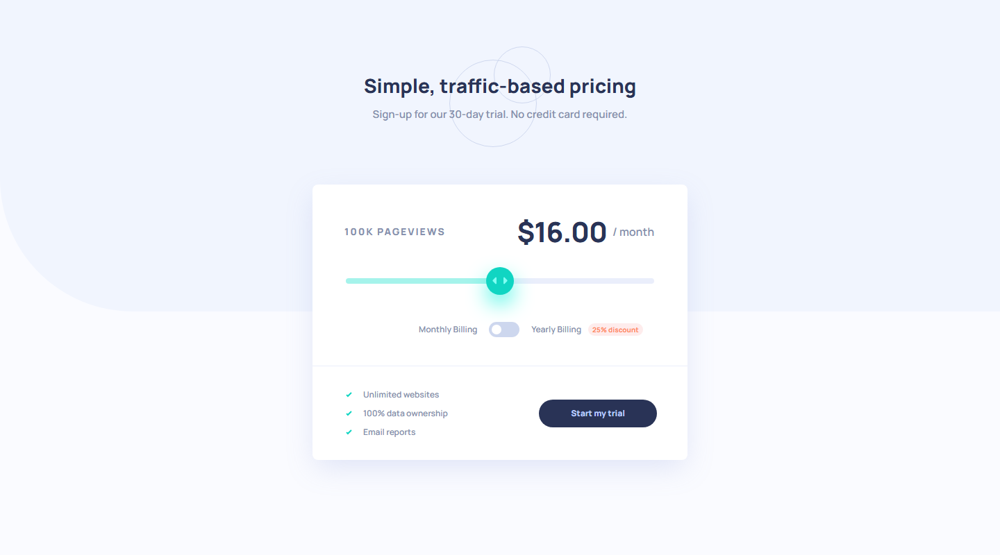
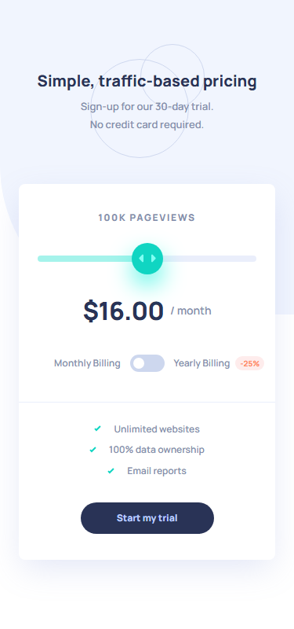

# Frontend Mentor - Interactive pricing component solution

This is a solution to the [Interactive pricing component challenge on Frontend Mentor](https://www.frontendmentor.io/challenges/interactive-pricing-component-t0m8PIyY8). Frontend Mentor challenges help you improve your coding skills by building realistic projects.

## Table of contents

- [Overview](#overview)
  - [The challenge](#the-challenge)
  - [Screenshot](#screenshot)
  - [Links](#links)
- [My process](#my-process)
  - [Built with](#built-with)
  - [What I learned](#what-i-learned)
  - [Continued development](#continued-development)
  - [Useful resources](#useful-resources)
- [Development](#development)
- [Author](#author)

## Overview

### The challenge

Users should be able to:

- View the optimal layout for the app depending on their device's screen size
- See hover states for all interactive elements on the page
- Use the slider and toggle to see prices for different page view numbers

| Pageviews | Monthly | Yearly (25% off, per month) |
| --------- | ------- | --------------------------- |
| 10K       | $8.00   | $6.00                       |
| 50K       | $12.00  | $9.00                       |
| 100K      | $16.00  | $12.00                      |
| 500K      | $24.00  | $18.00                      |
| 1M        | $36.00  | $27.00                      |

### Screenshot

| Desktop                              | Mobile                             |
| ------------------------------------ | ---------------------------------- |
|  |  |

### Links

- Solution URL: [Vercel](https://interactive-pricing-component-main.vercel.app/)
- Live Site URL: [mmalabugin.ru/InteractivePricingComponent](https://mmalabugin.ru/InteractivePricingComponent/)

## My process

### Built with

- **[Nuxt 4](https://nuxt.com/) (Vue 3.5, Vite)** — this challenge's new framework. `nuxt generate` prerenders the page to static HTML (Nitro's prerenderer), so the card is visible before any JavaScript runs; Vue then hydrates it for the slider and toggle.
- **FSD inside Nuxt's `app/` directory.** Nuxt reserves `pages/` for file-based routes, but in FSD `pages` is a layer — so `dir.pages` is pointed at `app/routes` (one `index.vue` that renders the page slice) and component auto-imports are switched off (`components.dirs: []`): every slice imports its dependencies explicitly through its `index.ts` public API.
  - `shared` — `RangeSlider`, `ToggleSwitch`, `IconCheck`, `formatUsd`, `clamp` / `progressPercent`
  - `entities/plan` — tiers, the 25% yearly discount, `priceFor`, `PriceTag`, `PerkList`
  - `features` — `select-pageviews` (tier slider), `toggle-billing` (monthly/yearly switch + badge)
  - `widgets` — `pricing-card` (with the `usePricing` composable), `pricing-header`
  - `pages/pricing`
- **Logic outside templates.** Pricing is pure functions in `entities/plan/model`; the card's state is a tiny `usePricing()` composable (`tierIndex`, `billing` refs + computed `tier` / `price`). Components bind with `defineModel()` and writable `computed` adapters (`boolean ⇄ 'monthly' | 'yearly'`, `number → clamped tier index`).
- **Native controls, custom skin.** The slider is a real `<input type="range">` and the toggle is `<input type="checkbox" role="switch">` with `appearance: none`, so keyboard, touch, focus and screen readers work for free. The filled part of the track is a gradient whose stop is derived from a `--fill` ratio and the thumb width (`calc(thumb / 2 + (100% - thumb) * var(--fill))`), so the fill ends exactly under the thumb's centre; Firefox uses `::-moz-range-progress`.
- **Accessibility.** `aria-valuetext="100K pageviews"` instead of "2", the price is an `aria-live="polite"` region, the switch is labelled by "Yearly Billing" and described by the discount badge. The mobile badge shows `-25%` visually while assistive tech still reads "25% discount".
- **Performance.** Prerendered HTML; Manrope is a single variable Latin woff2 (24 kB) bundled through Vite, preloaded from the same hashed URL as `@font-face` (`?url` import + `useHead`), with `font-display: optional`. Small SVGs and the favicon are inlined. CSS is 4.6 kB gzipped.
- Desktop-first CSS (BEM in scoped styles), `em` media queries, `rem` sizes, motion only inside `@media (prefers-reduced-motion: no-preference)`.
- **Tests:** Vitest + `@vue/test-utils` + happy-dom — 83 tests: unit tests for the pricing model, formatters and `usePricing`, a test for every component (including `app.vue` with a stubbed `useHead`), and an integration suite that drives the real slider and switch through all tiers in both billing modes. Plus `eslint-plugin-vue` and `nuxt typecheck` (vue-tsc).

### What I learned

- **`useId()` repeats across Vue apps.** Each `mount()` creates a new app, and `useId()` starts counting again — so with several mounted cards in one document the `<label for>` of the second card pointed at the first card's switch. In the browser there is one app, but the tests needed `enableAutoUnmount`.
- **Tests next to routes become routes.** Nuxt scans every `.ts` in the pages directory, so a colocated `index.test.ts` would have shipped as `/index.test`. `ignore: ['**/*.test.ts']` keeps colocated tests out of routing and the bundle.
- **Strings in `public/` don't follow `app.baseURL` everywhere.** Importing the font and favicon with `?url` makes Vite emit hashed files under `_nuxt/`, and the URLs pick up the base path automatically — `main` and `deploy` differ by one commented line.
- **Pixel matching by measurement and fitting.** Element boxes were compared against the JPG designs with Pillow (0–2 px off on both breakpoints); the background shape, the circles' offset, the card shadow and the thumb glow were fitted by rendering grids of candidate CSS values in Playwright and scoring the mean pixel difference.
- **The mobile switch is centred, not the group.** In the mobile design the switch sits on the card's axis with the labels hanging off both sides — a `minmax(0, 1fr) auto minmax(0, 1fr)` grid, not a centred flex row.

### Continued development

- The Nuxt runtime is ~71 kB gzipped for a page with two inputs; an islands/partial-hydration setup (`<NuxtIsland>` or `nuxt-islands`) could hydrate only the card.
- Persisting the selection in the URL query (`?views=1M&billing=yearly`) for shareable quotes.

### Useful resources

- [Nuxt directory structure](https://nuxt.com/docs/guide/directory-structure/app) and [`dir` config](https://nuxt.com/docs/api/nuxt-config#dir) — moving `pages` out of the way for FSD.
- [Vue `defineModel`](https://vuejs.org/api/sfc-script-setup.html#definemodel) and [`useId`](https://vuejs.org/api/composition-api-helpers.html#useid).
- [Styling range inputs](https://css-tricks.com/styling-cross-browser-compatible-range-inputs-css/).
- [Feature-Sliced Design](https://feature-sliced.design/).

## Development

```bash
npm install          # postinstall runs `nuxt prepare` (types in .nuxt/)
npm run dev          # dev server
npm test             # vitest (unit + component + integration)
npm run lint         # eslint + eslint-plugin-vue
npm run typecheck    # nuxt typecheck (vue-tsc)
npm run generate     # static prerender → .output/public
```

Deploy convention: `main` targets **Vercel** (`app.baseURL` stays commented, the site is served from `/`). The `deploy` branch uncomments `baseURL: '/InteractivePricingComponent/'` in `nuxt.config.ts`. Jenkins builds that branch into an nginx image and Kubernetes serves it at `mmalabugin.ru/InteractivePricingComponent/`.

## Author

- Website - [mmalabugin.ru](https://mmalabugin.ru/)
- Frontend Mentor - [@1t1sCooL](https://www.frontendmentor.io/profile/1t1sCooL)
- Twitter - [@vi_el_mar](https://www.twitter.com/vi_el_mar)
- Telegram - [@ItIsCooL](https://t.me/ItIsCooL)
